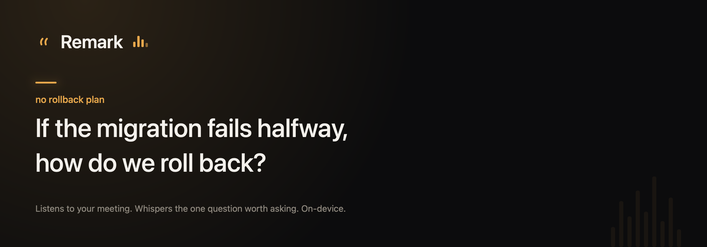

<p align="center">
  
</p>

<p align="center">
  <b>A macOS menu-bar app that listens to your meeting and whispers the one question worth asking.</b><br>
  On-device transcription. It stays quiet until there's a question worth asking.
</p>

---

Remark sits in your menu bar. When a meeting starts it quietly listens, and once in a while - only when it matters - it surfaces a single question you could ask out loud, in plain words: the edge case nobody handled, the number with no baseline, the decision left hanging. It stays silent the rest of the time, because a so-so question is worse than none.

It also remembers. After each meeting it distills what was discussed into an encrypted, on-device record, so the next meeting's questions can follow up on what was left open.

## What makes it different

- **Quiet by default.** Most moments earn nothing, so Remark stays silent until there's a question genuinely worth asking.
- **Runs on your Mac.** Audio is captured and transcribed locally with [Parakeet](https://github.com/k2-fsa/sherpa-onnx). Only the rolling text is sent to your Claude subscription to write a question - never the audio.
- **Remembers between meetings.** Each meeting is distilled and stored **AES-GCM encrypted** (key in your login Keychain). The next meeting gets a short brief of recurring topics, past decisions, and open threads.
- **Learns your taste.** 👍 / 👎 on a question teaches the next meeting what you actually want to ask.
- **No screen recording.** System audio is read through a Core Audio process tap - the "System Audio Recording" permission, not screen capture.

## How it works

| Piece | What it does |
| --- | --- |
| `MeetingDetector` | Starts only when a real meeting app (Zoom, Teams, Slack huddle, a browser call…) actually holds the mic. Ignores dictation and background mic use. No calendar access. |
| `AudioCapture` | Core Audio process tap on system output (+ optional mic), converted to 16 kHz mono. Adapts to the output device's real sample rate. |
| `sidecar/transcribe_server.py` | On-device Parakeet (sherpa-onnx) streaming transcription. No audio leaves the machine. |
| `QuestionEngine` | A warm `claude -p` stream-json session. Emits one line: `gap | question`, or `-` for silence. |
| `Distiller` + `ContextStore` | At meeting's end, a one-shot `claude` distills the transcript; the record is encrypted and folded into a derived profile. |

## Building

Needs macOS 14.4+ (Core Audio taps) and the [Claude CLI](https://docs.claude.com/en/docs/claude-code) on your `PATH`. Fetch the Parakeet model into `./models/parakeet` and set up the sidecar venv first (see `sidecar/`).

```bash
bash build.sh          # compiles, bundles, ad-hoc signs → build/Remark.app
open build/Remark.app
```

Ad-hoc signing is enough to try it, but the Core Audio tap and the Keychain-backed encryption want a real **Developer ID**. Set yours and `build.sh notarize` to sign, notarize, and install to `/Applications`:

```bash
export REMARK_SIGN_IDENTITY="Developer ID Application: Your Name (TEAMID)"
export REMARK_NOTARY_PROFILE="your-notarytool-profile"   # xcrun notarytool store-credentials
bash build.sh notarize
```

The app keeps its runtime data (the Parakeet model, `learnings.md`, the encrypted `context/`) under `~/remark`. First launch asks for **Microphone** and **System Audio Recording**. After that Remark lives in the menu bar and appears on its own when you join a meeting.

- Ask on demand: ⌥Q, or the **ask now** button in the panel.
- Thumbs on a question teach the next meeting (stored locally in `learnings.md`).

## Privacy

- Raw audio never leaves your Mac - transcription is fully on-device.
- Meeting records and the derived profile are AES-GCM encrypted at rest, keyed from your login Keychain.
- Question generation sends the rolling transcript text to your own Claude subscription for inference; that is the only text that leaves the machine.
- `learnings.md` and the thumbs journal are stored in plain text on your Mac (git-ignored).

## Status

Early and personal. Rough edges:

- The ChatGPT/Codex engine option in the menu currently routes to Claude.
- Fonts fall back to the system font unless Geist is installed.
- The Python sidecar and Parakeet model are fetched separately rather than bundled.
- macOS shows a small recording indicator while capturing - that's the OS privacy floor, and it can't be removed.
